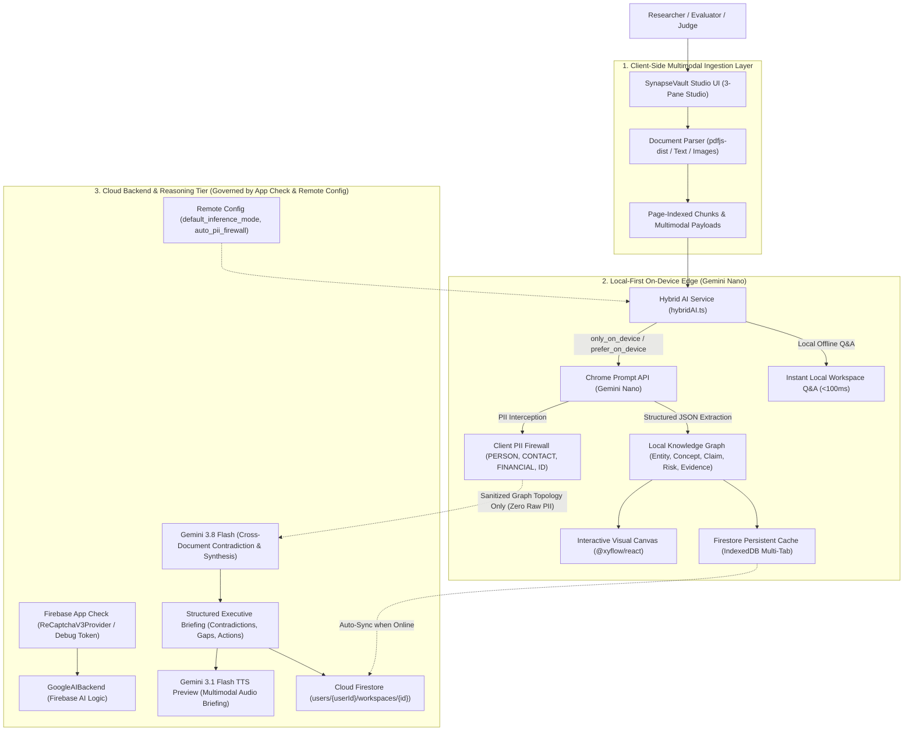

# SynapseVault 🧠🔐
> **Local-First Multimodal Knowledge Graph & Private Research OS**  
> Built for the **#BuildHybridAI 2026** Hackathon with **Firebase AI Logic** (`gemini-3.8-flash`, `gemini-3.1-flash-tts-preview`) and **Chrome Prompt API** (`Gemini Nano`).

[](https://firebase.google.com/)
[](https://ai.google.dev/)
[](https://ai.google.dev/)
[](https://developer.chrome.com/docs/ai/built-in)
[](https://firebase.google.com/docs/app-check)
[](https://developer.mozilla.org/en-US/docs/Web/Progressive_web_apps)
[](LICENSE)

---

## 1. Problem Statement & Why Hybrid AI Is Required

Modern researchers, forensic engineers, intelligence analysts, and corporate auditors analyze confidential multi-source evidence: internal incident logs, vendor proprietary spec sheets, customer reports, and compliance audits.

They face five critical engineering bottlenecks that pure cloud or pure on-device AI architectures fail to solve independently:

1. **The Cloud Privacy Dilemma**: Unfiltered customer PII, corporate credentials, bank account numbers, and personal identifiers cannot legally or ethically be sent to public cloud LLMs over the open web.
2. **The Air-Gapped / Offline Reality**: Field inspections, flight testing, and military/industrial research take place in secure facilities or remote regions where Internet access is intermittent, degraded, or strictly forbidden.
3. **Latency & Micro-Task Costs**: Running hundreds of micro-extractions (entity recognition, token redaction, atomic relation parsing) in the cloud incurs round-trip network delays (1,000–3,000ms per call) and massive API token costs.
4. **The On-Device Reasoning Limit**: Small local models (e.g. Gemini Nano) are exceptional at deterministic, structured, low-latency extraction, but lack the global attention context required for multi-document contradiction reasoning, cross-source forensic synthesis, and studio-grade voice generation.
5. **The Solution — Hybrid AI**: SynapseVault combines **on-device Gemini Nano 4** (running locally in the browser with 0 bytes network egress and $0 cost for PII redaction and graph parsing) with **Cloud Gemini 3.8 Flash & Gemini 3.1 Flash TTS** (via Firebase AI Logic with App Check protection) for sanitized, cross-document reasoning.

---

## 2. System Architecture Diagram



---

## 3. Flagship 3-Pane Studio Interface

SynapseVault provides a purpose-built dark-mode studio interface designed for evaluator clarity:

### 1. Persistent Hybrid Telemetry & Control HUD (`src/components/TelemetryHeader.tsx`)
- **Left**: SynapseVault brand identity + real-time Network Status pill (`Online` vs `Offline`) + Firestore Multi-Tab Persistence pill (`Synced` vs `Offline Cache Active`).
- **Center**: Live Gemini Nano 4 model readiness state (`Ready`, `Downloading X%`, or `Cloud Fallback Active`) + Interactive routing segmented control (`Auto Hybrid`, `Strict Local`, `Cloud Compare`).
- **Right**: Real-time telemetry strip displaying execution source (`on-device` vs `cloud`), latency (`ms`), and cumulative Local Privacy & Cost Savings counter (`total local runs` + estimated `USD saved`).
- **Interactive Benchmark Button**: Direct access to the Side-by-Side Hybrid Benchmark modal.

### 2. Left Pane — Source Vault & 1-Click Judge Demo (`src/components/SourceVault.tsx`)
- Universal drag-and-drop ingestion zone supporting **PDF**, **TXT/MD**, and **JPEG/PNG/WebP** files.
- **"Load Sample Investigation"**: 1-click button populating the **Project Helios Battery Thermal Incident** multi-document case study:
  1. *Field Engineering Log #4B*: Contains lead engineer PII (Marcus Vance, SSN, personal phone, JPMorgan Chase account) and telemetry recording an 88°C spike and emergency vent rupture.
  2. *Vendor Cell Spec Sheet*: Lithium-Titanate datasheet rating continuous operation strictly at 65°C, warning that >75°C invalidates warranty and causes separator breakdown.
  3. *Quality Audit Memo*: Firmware 2.4.0 certification claiming zero thermal limit excursions above 65°C occurred (a direct contradiction with Document 1 & 2).
- Status badges per source document: `Parsed`, `Redacted Locally`, and `Graph Indexed`.

### 3. Center Pane — Interactive Knowledge Graph Canvas (`src/components/GraphCanvas.tsx`)
- Interactive graph canvas built on `@xyflow/react` with custom color-coded nodes:
  - 🟢 **Entity**: Named hardware, components, and organizations.
  - 🟣 **Concept**: Protocols, firmware architectures, and physical processes.
  - 🔵 **Claim**: Engineering assertions and field observations.
  - 🔴 **Risk**: Thermal runway, safety vent ruptures, and warranty invalidations.
  - 🟡 **Evidence**: Sensor logs, pressure transducers, and audit certifications.
- **Animated `CONTRADICTS` Edges**: Highlighted with high-contrast amber/red animated dashed lines.
- **Node Detail Inspection**: Click any node to inspect connected claims, extraction confidence, and on-device extraction latency.
- **Floating Offline Search & Q&A**: Filter nodes by keyword and execute instant single-turn offline Q&A using Gemini Nano over local context without network latency.

### 4. Right Pane — Hybrid Intelligence Inspector (`src/components/IntelligencePanel.tsx`)
- **Tab 1: Privacy Firewall**: Side-by-side diff comparison between raw local data and sanitized text with highlighted PII badges (`[REDACTED_PERSON]`, `[REDACTED_CONTACT]`, `[REDACTED_FINANCIAL]`, `[REDACTED_ID]`) and PII registry.
- **Tab 2: Cloud Synthesis**: Tier 2 Cloud Escalation button sending **only** sanitized text and graph topology to `gemini-3.8-flash`. Includes collapsible wire JSON inspector, Executive Summary, Detected Contradictions (prominently flagged in amber/red with citations), Knowledge Gaps, and Action Plan.
- **Tab 3: Audio Briefing**: Multimodal audio player powered by `gemini-3.1-flash-tts-preview` (with browser Web Speech API offline fallback), animated waveform visualizer, playback controls, and `.wav` download.

### 5. Side-by-Side Hybrid Benchmark Mode (`src/components/BenchmarkModal.tsx`)
- Runs identical prompt inputs simultaneously through **On-Device Gemini Nano** and **Cloud Gemini 3.8 Flash**.
- Displays a factual side-by-side comparison table:
  - **Execution Latency**: On-device (~120–350ms) vs Cloud API (~1,200–2,400ms).
  - **Network Egress**: 0 Bytes (Air-gapped) vs Wire payload bytes.
  - **Privacy Exposure**: 100% Zero Leakage vs Cloud Wire Transmission.
  - **Inference Cost**: $0.000000 (Free) vs Cloud API token pricing.
  - **Offline Capability**: 100% Functional in Airplane Mode vs Requires Internet Connection.

---

## 4. Security & Compliance Foundation

- **Firebase App Check**:
  - `initializeAppCheck` is configured using `ReCaptchaV3Provider`.
  - Configured strictly prior to any `getAI()` call in [`src/lib/firebase.ts`](src/lib/firebase.ts).
  - Includes `self.FIREBASE_APPCHECK_DEBUG_TOKEN` support for local judging, CI, and emulators.
- **Cloud Firestore Security Rules (`firestore.rules`)**:
  - Strict user-isolation rule enforced across all paths:
    ```javascript
    rules_version = '2';
    service cloud.firestore {
      match /databases/{database}/documents {
        match /{document=**} {
          allow read, write: false;
        }
        match /users/{userId} {
          allow read, write: if request.auth != null && request.auth.uid == userId;
          match /workspaces/{workspaceId} {
            allow read, write: if request.auth != null && request.auth.uid == userId;
            match /{allSubcollections=**} {
              allow read, write: if request.auth != null && request.auth.uid == userId;
            }
          }
          match /records/{recordId} {
            allow read, write: if request.auth != null && request.auth.uid == userId;
            match /{allSubcollections=**} {
              allow read, write: if request.auth != null && request.auth.uid == userId;
            }
          }
        }
      }
    }
    ```
- **Error Boundaries**:
  - React Error Boundaries wrap the Knowledge Graph Canvas and document parsing pipeline in [`src/components/ErrorBoundary.tsx`](src/components/ErrorBoundary.tsx) and [`src/services/documentParser.ts`](src/services/documentParser.ts).
  - Malformed or corrupt PDFs are intercepted with plain-text fallback recovery; the application never crashes.
- **Zero Hardcoded Credentials**:
  - Zero API keys, secrets, or service account credentials exist in source code. All configuration is loaded from environment variables (`VITE_FIREBASE_*`).
- **Apache 2.0 License**:
  - Open-source compliant [LICENSE](LICENSE) in repository root.

---

## 5. Local Setup Instructions

### Prerequisites
- **Node.js**: v20+ or v24+
- **npm**: v10+
- **Browser**: Google Chrome 139+ (for on-device Gemini Nano testing) or any modern browser (for graceful cloud fallback)

### Installation
```bash
# 1. Clone the repository
git clone https://github.com/ritesh-1912/Firebase-Hackathon.git
cd Firebase-Hackathon

# 2. Install dependencies
npm install

# 3. Create your local environment configuration
cp .env.example .env

# 4. Start the local Vite development server
npm run dev
```

---

## 6. Chrome v139+ Gemini Nano Setup Guide

To test browser-native on-device inference using Gemini Nano in Google Chrome:

1. **Open Google Chrome 139+** (Chrome Canary, Dev, or Chrome 139+ with experimental AI flags enabled).
2. Navigate to `chrome://flags` and configure the following flags:
   - `#prompt-api-for-gemini-nano`: Set to **Enabled**.
   - `#prompt-api-for-gemini-nano-multimodal-input`: Set to **Enabled**.
   - `#optimization-guide-on-device-model`: Set to **Enabled BypassPerfRequirement**.
3. Relaunch Chrome.
4. Verify on-device model installation:
   - Open `chrome://components`
   - Locate **Optimization Guide On Device Model**
   - Click **Check for update** until status indicates *Up-to-date*.
5. Open SynapseVault (`http://localhost:5173`). The Persistent Telemetry HUD will indicate:
   `On-Device Model Status: AVAILABLE (GEMINI NANO)`.

> [!NOTE]
> **Graceful Degradation:** If tested in Safari, Firefox, or Chrome without flags, SynapseVault gracefully degrades to Cloud `gemini-3.8-flash` via Firebase AI Logic and displays a non-intrusive status notice.

---

## 7. App Check Debug Token Configuration

For evaluators running locally:
1. In development mode (`npm run dev`), the app automatically registers a debug token in your browser console:
   ```
   [Firebase App Check] App Check debug token: 'XXXXXXXX-XXXX-XXXX-XXXX-XXXXXXXXXXXX'
   ```
2. To whitelist your debug token in Firebase:
   - Navigate to **Firebase Console -> App Check -> Apps -> Manage debug tokens**.
   - Add your debug token to allow local API access.
3. Alternatively, set your token in `.env`:
   ```bash
   VITE_FIREBASE_APPCHECK_DEBUG_TOKEN=true
   ```

---

## 8. Firebase Remote Config Parameters

| Parameter | Type | Default | Purpose |
| :--- | :--- | :--- | :--- |
| `default_inference_mode` | String | `"prefer_on_device"` | Sets global inference routing (`prefer_on_device`, `only_on_device`, `only_in_cloud`). |
| `auto_pii_firewall` | Boolean | `true` | Enforces client-side PII sanitization before writing to Firestore or forwarding data to cloud tiers. |

---

## 9. Tech Stack

- **Client Runtime**: React 18, TypeScript 5, Vite 6, Tailwind CSS 3
- **Local On-Device AI**: Chrome Prompt API (`LanguageModel.availability()`, Gemini Nano)
- **Cloud Multimodal AI**: Firebase AI Logic (`getAI()`, `getGenerativeModel()`, `GoogleAIBackend`, `gemini-3.8-flash`, `gemini-3.1-flash-tts-preview`)
- **Security & Infrastructure**: Firebase App Check (reCAPTCHA v3), Firebase Auth (Anonymous & Google), Cloud Firestore (Offline Multi-Tab Persistence), Firebase Remote Config
- **Visuals & Graphs**: `@xyflow/react` (interactive canvas, minimap, auto-layout, animated conflict edges)
- **Document & Multimodal Parser**: `pdfjs-dist` (browser-native worker)
- **PWA / Offline**: `vite-plugin-pwa` (Workbox precaching and service worker)

---

## 10. License

This project is licensed under the **Apache 2.0 License** — see the [LICENSE](LICENSE) file for details.
