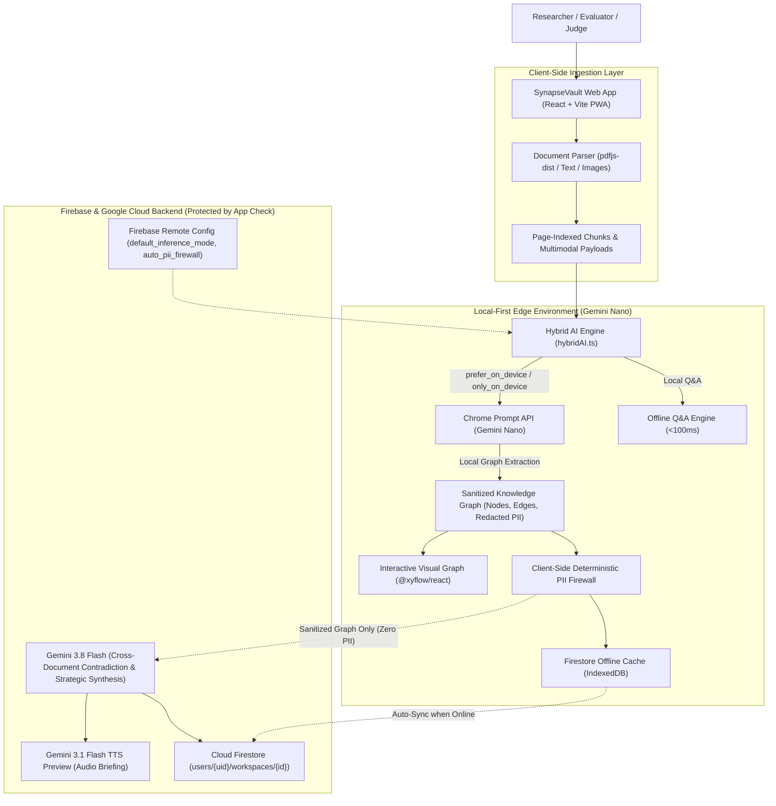

# SynapseVault 🧠🔐
> **Local-First Multimodal Knowledge Graph & Private Research OS**  
> Built for the **#BuildHybridAI 2026** Hackathon with **Firebase AI Logic** (`gemini-3.8-flash`, `gemini-3.1-flash-tts-preview`) and **Chrome Prompt API** (`Gemini Nano`).

[](https://firebase.google.com/)
[](https://ai.google.dev/)
[](https://ai.google.dev/)
[](https://developer.chrome.com/docs/ai/built-in)
[](https://developer.mozilla.org/en-US/docs/Web/Progressive_web_apps)
[](LICENSE)

---

## 1. Project Overview & Value Proposition

Researchers, intelligence analysts, legal teams, and industrial auditors deal with high-value, sensitive information (proprietary patents, medical records, financial escrow details, and zero-day threat reports).
They face critical constraints:
1. **Zero-Trust PII Privacy**: Confidential names, phone numbers, crypto/bank accounts, and national IDs must never leave the local client device unredacted.
2. **100% Offline Resilience**: Critical investigations happen in field conditions, offline air-gapped rooms, and aircraft cabins without network access.
3. **Sub-100ms Knowledge Graph Extraction**: Real-time extraction of atomic knowledge nodes and relationship edges without waiting for cloud API queues.
4. **Cloud Escalation for Deep Reasoning**: When cross-document contradiction detection, knowledge gap discovery, and multi-perspective strategic synthesis are required, sanitized graph data is escalated to Gemini 3.8 Flash.
5. **Executive Audio Briefings**: Immediate audio synthesis of executive intelligence briefings using `gemini-3.1-flash-tts-preview`.

---

## 2. Core Typed Pipeline Architecture

SynapseVault partitions AI tasks between **Local Edge (Gemini Nano)** and **Cloud (Gemini 3.8 Flash + TTS)**:

| Operation | Mode / Model | Purpose & Output |
| :--- | :--- | :--- |
| **`redactAndExtractLocal`** | `prefer_on_device` / `only_on_device`<br>(Gemini Nano) | Extracts typed knowledge graph (`Entity`, `Concept`, `Claim`, `Risk`, `Evidence`) and relationship edges (`SUPPORTS`, `CONTRADICTS`, `DEPENDS_ON`, `MENTIONS`) while strictly redacting PII (`[REDACTED_PERSON]`, `[REDACTED_CONTACT]`, `[REDACTED_FINANCIAL]`, `[REDACTED_ID]`). |
| **`queryLocalWorkspace`** | `prefer_on_device`<br>(Gemini Nano) | Fast, single-turn offline Q&A over local sanitized knowledge context with zero cloud data transmission. |
| **`synthesizeCloudBriefing`** | `only_in_cloud`<br>(`gemini-3.8-flash`) | Deep cross-document analysis using **ONLY** sanitized text and graph topology. Detects contradictions, uncovers knowledge gaps, and formulates strategic actions. |
| **`generateAudioBriefing`** | `only_in_cloud` with Web Speech fallback<br>(`gemini-3.1-flash-tts-preview`) | Studio-grade client-side voice synthesis (Puck voice persona) with 24kHz WAV decoding. Graceful fallback to browser Web Speech API when offline. |

---

## 3. System Architecture Diagram



---

## 4. Firestore Data Layer (`users/{uid}/workspaces/{workspaceId}`)

```typescript
export interface WorkspaceRecord {
  id: string;
  name: string;
  description?: string;
  sources: Array<{
    id: string;
    fileName: string;
    fileType: 'pdf' | 'markdown' | 'text' | 'image';
    sizeBytes: number;
    uploadedAt: number;
    chunkCount: number;
  }>;
  redactedText: string;
  redactionsCount: number;
  nodes: Array<{
    id: string;
    label: string;
    category: 'Entity' | 'Concept' | 'Claim' | 'Risk' | 'Evidence';
    summary: string;
    confidence: number;
  }>;
  edges: Array<{
    source: string;
    target: string;
    relation: 'SUPPORTS' | 'CONTRADICTS' | 'DEPENDS_ON' | 'MENTIONS';
  }>;
  cloudBriefing?: {
    executiveSummary: string;
    contradictions: Array<{
      claimA: string;
      claimB: string;
      conflictReason: string;
      citation?: string;
    }>;
    knowledgeGaps: string[];
    recommendedActions: string[];
  };
  lastTelemetry?: {
    executionSource: 'on-device' | 'cloud';
    latencyMs: number;
    fallbackTriggered: boolean;
    estimatedTokensSaved: number;
    estimatedCostSavedUsd: number;
  };
  audioGenerated?: boolean;
  audioUrl?: string;
  isOfflineCreated: boolean;
  createdAt: number;
  updatedAt: number;
}
```

---

## 5. Local Setup Instructions

### Prerequisites
- **Node.js**: v20+ or v24+
- **npm**: v10+
- **Browser**: Google Chrome 139+ (for on-device Gemini Nano testing) or any modern browser (for graceful cloud fallback)

### Installation
```bash
# 1. Clone the repository
git clone https://github.com/ritesh-1912/Firebase-Hackathon.git
cd Firebase-Hackathon

# 2. Install dependencies (including pdfjs-dist, @xyflow/react, vite-plugin-pwa)
npm install

# 3. Create your local environment file
cp .env.example .env

# 4. Start the local development server
npm run dev
```

---

## 6. Chrome v139+ Gemini Nano Setup Guide

To experience true on-device inference using Gemini Nano in Google Chrome:

1. **Launch Google Chrome 139+** (Chrome Canary, Dev, or current Chrome with experimental AI features).
2. Navigate to `chrome://flags` and configure the following flags:
   - `#prompt-api-for-gemini-nano`: Set to **Enabled**.
   - `#prompt-api-for-gemini-nano-multimodal-input`: Set to **Enabled**.
   - `#optimization-guide-on-device-model`: Set to **Enabled BypassPerfRequirement**.
3. Relaunch Chrome.
4. Verify model download:
   - Go to `chrome://components`
   - Locate **Optimization Guide On Device Model**
   - Click **Check for update** until the status reads *Up-to-date*.
5. Open the app (`http://localhost:5173`). The Persistent Telemetry Bar will display:
   `On-Device Model Status: AVAILABLE (GEMINI NANO)`.

> [!NOTE]
> **Graceful Degradation:** If opened in Safari, Firefox, or Chrome without the Prompt API flags, the application **never crashes**. It displays an informative notice and transparently routes inferences to Cloud `gemini-3.8-flash` via Firebase AI Logic.

---

## 7. Firebase Remote Config Parameters

| Parameter | Type | Default | Description |
| :--- | :--- | :--- | :--- |
| `default_inference_mode` | String | `"prefer_on_device"` | Global routing policy (`prefer_on_device`, `only_on_device`, `only_in_cloud`). |
| `auto_pii_firewall` | Boolean | `true` | Enforces client-side PII sanitization before any data can be written to Firestore or sent to cloud models. |

---

## 8. Deployment Configuration

### Progressive Web App (PWA) Offline Support
Configured via `vite-plugin-pwa` in `vite.config.ts`. All assets (HTML, CSS, JS, fonts, icons, wasm) are cached by a generated Service Worker (`dist/sw.js`) enabling 100% offline app launch and local-first execution.

### Firebase Hosting
```bash
# Build the application
npm run build

# Deploy to Firebase Hosting
npx firebase-tools deploy --only hosting
```

---

## 9. License

This project is licensed under the **Apache 2.0 License** - see the [LICENSE](LICENSE) file for details.
