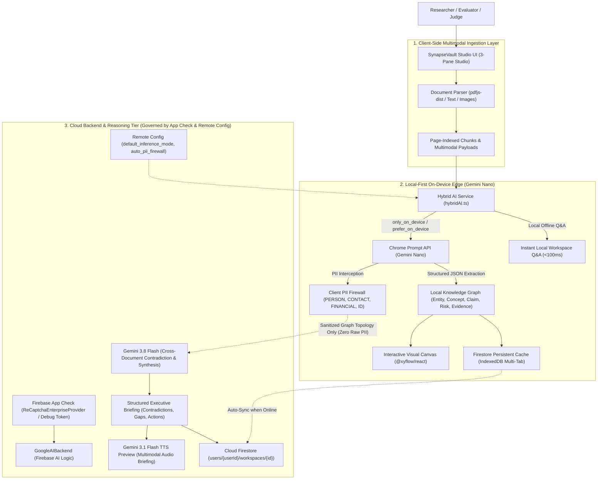

# SynapseVault 🧠🔐
> **Local-First Multimodal Knowledge Graph & Private Research OS**  
> Built for the **#BuildHybridAI 2026** Hackathon with **Firebase AI Logic** (`gemini-3.8-flash`, `gemini-3.1-flash-tts-preview`) and **Chrome Prompt API** (`Gemini Nano`).

- **Live Demo**: [https://synapsevault-38f14.web.app](https://synapsevault-38f14.web.app) *(Note: Firebase App Check uses a debug token for hackathon evaluation so judges can test across environments without reCAPTCHA friction.)*

[](https://firebase.google.com/)
[](https://ai.google.dev/)
[](https://ai.google.dev/)
[](https://developer.chrome.com/docs/ai/built-in)
[](https://firebase.google.com/docs/app-check)
[](https://developer.mozilla.org/en-US/docs/Web/Progressive_web_apps)
[](LICENSE)

---

## 1. Problem Statement & Why Hybrid AI Is Required

Modern researchers, forensic engineers, intelligence analysts, and corporate auditors analyze confidential multi-source evidence: internal incident logs, vendor proprietary spec sheets, customer reports, and compliance audits.

They face five critical engineering bottlenecks that pure cloud or pure on-device AI architectures fail to solve independently:

1. **The Cloud Privacy Dilemma**: Unfiltered customer PII, corporate credentials, bank account numbers, and personal identifiers cannot legally or ethically be sent to public cloud LLMs over the open web.
2. **The Air-Gapped / Offline Reality**: Field inspections, flight testing, and military/industrial research take place in secure facilities or remote regions where Internet access is intermittent, degraded, or strictly forbidden.
3. **Latency & Micro-Task Costs**: Running hundreds of micro-extractions (entity recognition, token redaction, atomic relation parsing) in the cloud incurs round-trip network delays (1,000–3,000ms per call) and massive API token costs.
4. **The On-Device Reasoning Limit**: Small local models (e.g. Gemini Nano) are exceptional at deterministic, structured, low-latency extraction, but lack the global attention context required for multi-document contradiction reasoning, cross-source forensic synthesis, and studio-grade voice generation.
5. **The Solution — Hybrid AI**: SynapseVault combines **on-device Gemini Nano 4** (running locally in the browser with 0 bytes network egress and $0 cost for PII redaction and graph parsing) with **Cloud Gemini 3.8 Flash & Gemini 3.1 Flash TTS** (via Firebase AI Logic with App Check protection) for sanitized, cross-document reasoning.

---

## 2. System Architecture Diagram



---

## 3. Archival Paper & Ink Editorial Workspace (`#FBFBF9`)

SynapseVault uses a quiet, restrained paper-and-ink editorial workspace inspired by Notion, Readwise Reader, and Apple Notes:

### 1. Minimal 48px Top Bar & Engine Popover (`src/components/TelemetryHeader.tsx`)
- **Left**: Collapsible sidebar toggle + `SynapseVault` wordmark in `Newsreader`.
- **Center**: Underline navigation tabs: **`Canvas`** | **`Redactions`** | **`Briefing`**.
- **Right**:
  - **Engine Status Trigger**: Compact `6px` dot (`#166534` Local, `#1D4ED8` Cloud) + latency label (`Local · 142ms` or `Cloud`). Clicking opens a white popover with **Routing Mode** radio controls (`Auto Hybrid`, `Strict Local`, `Cloud Only`), Gemini Nano status/download progress, non-Chrome fallback guidance, total local runs / `$` saved, and **`Run local vs. cloud benchmark`**.
  - **Account Control**: Compact avatar initial / `Sign in` menu (Anonymous Judge auto-auth with optional Google Sign-In).

### 2. Editorial Empty State & 240px Source Sidebar (`src/components/SourceVault.tsx`)
- **Empty State**: Centered editorial canvas on `#FBFBF9` with `Newsreader` headline (*"Private research, mapped locally."*), concise summary, solid `#141413` **`Load sample case study`** button (1-click launch of the **Project Helios** 3-document case study), and bordered **`Upload files`** button.
- **Collapsible `240px` `#F3F3EF` Sidebar**: Clean vertical list of loaded files (clicking focuses a document on the canvas), `+ Add documents` dropzone (`PDF`, `MD`, `TXT`, `PNG`, `JPG`), and `Saved vaults` access.

### 3. Architectural Knowledge Graph Canvas (`src/components/GraphCanvas.tsx`)
- Full-height `#FBFBF9` canvas with subtle `#D8D8D2` dots (minimap removed for visual clarity).
- **Minimal Node Cards**: Crisp white rectangles (`#FFFFFF`, `1px` `#DFDFD9` border) showing solely a `6px` category dot and `13px` title.
- **Edges**: Thin `#C8C8C0` bezier curves; `CONTRADICTS` relations render as `#B91C1C` dashed curves with clean white-backed labels.
- **Bottom Ask Bar**: Centered Spotlight-style `"Ask your local vault..."` pill input displaying answers in a dismissible white popover directly above the input.
- **340px Slide-Over Inspector**: Clicking any node opens a right-side white drawer with category dot, `Newsreader` serif node title, summary, linked source, and connections.

### 4. Editorial Full-Page Views (`src/components/IntelligencePanel.tsx`)
- **`Redactions` Tab**: Single-line header summary (*"X sensitive items blocked locally before cloud sync"*), document selector dropdown, two-column split layout (`Original on device` vs. `Sanitized for cloud`) separated by a `1px` hairline divider, and stark `#141413` monospace `[REDACTED_*]` bars.
- **`Briefing` Tab**: Published-memo layout (`max-w-2xl`) with `Generate cloud briefing` + collapsible `Inspect sanitized payload`, `Newsreader` report title, minimal inline Audio Briefing bar (`gemini-3.1-flash-tts-preview` / Web Speech fallback), `Executive Summary`, `Detected Contradictions` (`2px` `#B91C1C` left border), `Knowledge Gaps`, and `Recommended Actions`.

### 5. Minimal Benchmark Modal (`src/components/BenchmarkModal.tsx`)
- Clean white modal (`"On-Device vs. Cloud Benchmark"`) with `Run comparison` button and border-collapsed `tabular-nums` comparison table (`Latency (ms)`, `Network Egress`, `Privacy Exposure`, `Cost`, `Extracted Nodes`).

---

## 4. Security & Compliance Foundation

- **Firebase App Check**:
  - `initializeAppCheck` is configured using `ReCaptchaEnterpriseProvider` with `VITE_FIREBASE_APPCHECK_DEBUG_TOKEN` support so hackathon evaluators can test without reCAPTCHA friction.
  - Configured strictly prior to any `getAI()` call in [`src/lib/firebase.ts`](src/lib/firebase.ts) and wrapped in `try/catch` diagnostics.
- **Cloud Firestore Security Rules (`firestore.rules`)**:
  - Strict user-isolation rule enforced across all paths:
    ```javascript
    rules_version = '2';
    service cloud.firestore {
      match /databases/{database}/documents {
        match /{document=**} {
          allow read, write: if false;
        }
        match /users/{userId} {
          allow read, write: if request.auth != null && request.auth.uid == userId;
          match /workspaces/{workspaceId} {
            allow read, write: if request.auth != null && request.auth.uid == userId;
            match /{allSubcollections=**} {
              allow read, write: if request.auth != null && request.auth.uid == userId;
            }
          }
          match /records/{recordId} {
            allow read, write: if request.auth != null && request.auth.uid == userId;
            match /{allSubcollections=**} {
              allow read, write: if request.auth != null && request.auth.uid == userId;
            }
          }
        }
      }
    }
    ```
- **Error Boundaries**:
  - React Error Boundaries wrap the Knowledge Graph Canvas and document parsing pipeline in [`src/components/ErrorBoundary.tsx`](src/components/ErrorBoundary.tsx) and [`src/services/documentParser.ts`](src/services/documentParser.ts).
  - Malformed or corrupt PDFs are intercepted with plain-text fallback recovery; the application never crashes.
- **Zero Hardcoded Credentials**:
  - Zero API keys, secrets, or service account credentials exist in source code. All configuration is loaded from environment variables (`VITE_FIREBASE_*`).
- **Apache 2.0 License**:
  - Open-source compliant [LICENSE](LICENSE) in repository root.

---

## 5. Local Setup Instructions

### Prerequisites
- **Node.js**: v20+ or v24+
- **npm**: v10+
- **Browser**: Google Chrome 139+ (for on-device Gemini Nano testing) or any modern browser (for graceful cloud fallback)

### Installation
```bash
# 1. Clone the repository
git clone https://github.com/ritesh-1912/Firebase-Hackathon.git
cd Firebase-Hackathon

# 2. Install dependencies
npm install

# 3. Create your local environment configuration
cp .env.example .env

# 4. Start the local Vite development server
npm run dev
```

---

## 6. Chrome v139+ Gemini Nano Setup Guide

To test browser-native on-device inference using Gemini Nano in Google Chrome:

1. **Open Google Chrome 139+** (Chrome Canary, Dev, or Chrome 139+ with experimental AI flags enabled).
2. Navigate to `chrome://flags` and configure the following flags:
   - `#prompt-api-for-gemini-nano`: Set to **Enabled**.
   - `#prompt-api-for-gemini-nano-multimodal-input`: Set to **Enabled**.
   - `#optimization-guide-on-device-model`: Set to **Enabled BypassPerfRequirement**.
3. Relaunch Chrome.
4. Verify on-device model installation:
   - Open `chrome://components`
   - Locate **Optimization Guide On Device Model**
   - Click **Check for update** until status indicates *Up-to-date*.
5. Open SynapseVault (`http://localhost:5173`). The engine indicator in the top bar will show **`Local`** (and clicking it opens the popover showing `Gemini Nano: Ready`).

> [!NOTE]
> **Graceful Degradation:** If tested in Safari, Firefox, or Chrome without flags, SynapseVault gracefully degrades to Cloud `gemini-3.8-flash` (with transient fallback) via Firebase AI Logic and surfaces the fallback note cleanly inside the engine popover.

---

## 7. App Check Debug Token Configuration

For evaluators running locally:
1. In development mode (`npm run dev`), the app automatically registers a debug token in your browser console:
   ```
   [Firebase App Check] App Check debug token: 'XXXXXXXX-XXXX-XXXX-XXXX-XXXXXXXXXXXX'
   ```
2. To whitelist your debug token in Firebase:
   - Navigate to **Firebase Console -> App Check -> Apps -> Manage debug tokens**.
   - Add your debug token to allow local API access.
3. Alternatively, set your token in `.env`:
   ```bash
   VITE_FIREBASE_APPCHECK_DEBUG_TOKEN=true
   ```

---

## 8. Firebase Remote Config Parameters

| Parameter | Type | Default | Purpose |
| :--- | :--- | :--- | :--- |
| `default_inference_mode` | String | `"prefer_on_device"` | Sets global inference routing (`prefer_on_device`, `only_on_device`, `only_in_cloud`). |
| `auto_pii_firewall` | Boolean | `true` | Enforces client-side PII sanitization before writing to Firestore or forwarding data to cloud tiers. |

---

## 9. Tech Stack

- **Client Runtime**: React 19, TypeScript 5, Vite 6, Tailwind CSS 4
- **Local On-Device AI**: Chrome Prompt API (`LanguageModel.availability()`, Gemini Nano)
- **Cloud Multimodal AI**: Firebase AI Logic (`getAI()`, `getGenerativeModel()`, `GoogleAIBackend`, `gemini-3.8-flash`, `gemini-3.1-flash-tts-preview`)
- **Security & Infrastructure**: Firebase App Check (`ReCaptchaEnterpriseProvider` + Debug Token), Firebase Auth (Anonymous & Google), Cloud Firestore (Offline Multi-Tab Persistence), Firebase Remote Config
- **Visuals & Graphs**: `@xyflow/react` (interactive canvas, minimap, auto-layout, animated conflict edges)
- **Document & Multimodal Parser**: `pdfjs-dist` (browser-native worker)
- **PWA / Offline**: `vite-plugin-pwa` (Workbox precaching and service worker)

---

## 10. License

This project is licensed under the **Apache 2.0 License** — see the [LICENSE](LICENSE) file for details.
