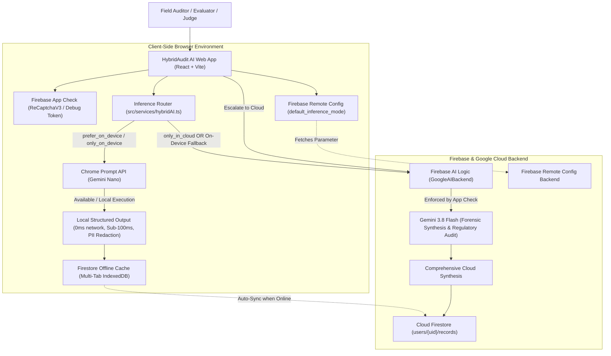

# HybridAudit AI 🛡️⚡
> **Privacy-First Document & Field Inspection Intelligence**  
> Built for the **#BuildHybridAI 2026** Hackathon with **Firebase AI Logic** (`gemini-3.8-flash`) and **Chrome Prompt API** (`Gemini Nano`).

[](https://firebase.google.com/)
[](https://ai.google.dev/)
[](https://developer.chrome.com/docs/ai/built-in)
[](LICENSE)

---

## 1. Project Overview & Value Proposition

In high-stakes industrial, medical, and financial environments (e.g., turbine field inspections, emergency medical invoices, internal security breaches), field workers and auditors operate under strict constraints:
1. **Strict Data Privacy & PII Compliance**: Sensitive identifiers (SSNs, patient IDs, corporate tokens, credit cards) must never leave the local device in unredacted raw form.
2. **Intermittent or Zero Connectivity**: Critical inspections frequently occur in disconnected environments (underground substations, remote plants, secure server rooms).
3. **Instant Latency Requirements**: Operators need real-time validation without round-trip network hops.
4. **Deep Strategic Escalation**: When high-level statutory compliance or forensic liability synthesis is required, the audit should seamlessly escalate to cloud intelligence.

### Why Hybrid Inference is Required
**HybridAudit AI** solves this by establishing a two-tier hybrid AI architecture:
- **Tier 1 (On-Device via Gemini Nano)**: Instant, zero-cloud-transmission PII redactor and structured JSON extractor. Runs in sub-100ms with zero network requests and full offline resilience.
- **Tier 2 (Cloud via Gemini 3.8 Flash)**: High-capacity forensic reasoning, regulatory risk analysis, and multi-step mitigation synthesis triggered on-demand or when cloud routing is selected.

---

## 2. Locked-In Application Concept

**Concept Name:** `HybridAudit AI — Privacy-First Document & Field Inspection Intelligence`

### Two-Tier Task Separation
| Dimension | Tier 1: On-Device (Gemini Nano) | Tier 2: Cloud (Gemini 3.8 Flash) |
| :--- | :--- | :--- |
| **Execution Engine** | Chrome Prompt API (`LanguageModel`) | Firebase AI Logic (`GoogleAIBackend`) |
| **Typical Latency** | 20ms – 120ms (Zero network overhead) | 600ms – 1,200ms |
| **Primary Tasks** | PII detection/redaction, field telemetry extraction, tactical action items, preliminary risk scoring (1-10) | Deep forensic risk audits, statutory policy compliance (OSHA, HIPAA, PCI-DSS), strategic mitigation roadmap |
| **Connectivity** | 100% Offline Capable | Online with App Check replay protection |
| **Output Schema** | Strict typed JSON Schema | Multi-perspective strategic synthesis |

### Firestore Data Model (`users/{uid}/records/{recordId}`)
```typescript
interface AuditRecord {
  id: string;
  title: string;
  category: "field_inspection" | "invoice_audit" | "security_incident" | "legal_compliance";
  rawPrompt: string;
  hasImage: boolean;
  imageUrl?: string;
  localStructuredData: {
    entities: Record<string, string | number>;
    piiDetected: boolean;
    piiEntities?: string[];
    riskScore: number; // 1-10
    quickSummary: string;
    actionItems: string[];
  };
  cloudSynthesis?: {
    executiveSummary: string;
    regulatoryRiskAnalysis: string;
    mitigationStrategy: string[];
    longTermComplianceScore: number; // 1-100
  };
  telemetry: {
    text: string;
    parsedJson?: any;
    executionSource: "on-device" | "cloud";
    latencyMs: number;
    fallbackTriggered: boolean;
    timestamp: number;
    modeUsed: "prefer_on_device" | "only_on_device" | "only_in_cloud";
  };
  cloudTelemetry?: {
    latencyMs: number;
    timestamp: number;
  };
  isOfflineCreated: boolean;
  createdAt: number;
}
```

---

## 3. System Architecture



---

## 4. Local Setup Instructions

### Prerequisites
- **Node.js**: v20+ or v24+
- **npm**: v10+
- **Browser**: Google Chrome 139+ (for on-device Gemini Nano testing) or any modern browser (for graceful cloud fallback)

### Installation
```bash
# 1. Clone the repository
git clone https://github.com/ritesh-1912/Firebase-Hackathon.git
cd Firebase-Hackathon

# 2. Install dependencies
npm install

# 3. Create your local environment file
cp .env.example .env

# 4. Start the local development server
npm run dev
```

---

## 5. Environment Variable Definitions (`.env`)

All Firebase configuration parameters are managed via Vite environment variables:

| Variable | Description |
| :--- | :--- |
| `VITE_FIREBASE_API_KEY` | Firebase Web API Key |
| `VITE_FIREBASE_AUTH_DOMAIN` | Firebase Authentication Domain |
| `VITE_FIREBASE_PROJECT_ID` | Firebase Project ID |
| `VITE_FIREBASE_STORAGE_BUCKET` | Firebase Storage Bucket |
| `VITE_FIREBASE_MESSAGING_SENDER_ID` | Firebase Cloud Messaging Sender ID |
| `VITE_FIREBASE_APP_ID` | Firebase Web App ID |
| `VITE_FIREBASE_MEASUREMENT_ID` | Google Analytics Measurement ID (optional) |
| `VITE_FIREBASE_RECAPTCHA_SITE_KEY` | reCAPTCHA v3 Site Key for Firebase App Check |
| `VITE_FIREBASE_APPCHECK_DEBUG_TOKEN` | App Check Debug Token (`true` or UUID) for dev/judging |

> [!IMPORTANT]
> `.env` is listed in `.gitignore` to prevent any credentials from being committed to source control.

---

## 6. Chrome v139+ Gemini Nano Setup Guide

To experience true on-device inference using Gemini Nano in Google Chrome:

1. **Launch Google Chrome 139+** (Chrome Canary, Dev, or current Chrome with experimental AI features).
2. Navigate to `chrome://flags` and configure the following flags:
   - `#prompt-api-for-gemini-nano`: Set to **Enabled**.
   - `#prompt-api-for-gemini-nano-multimodal-input`: Set to **Enabled**.
   - `#optimization-guide-on-device-model`: Set to **Enabled BypassPerfRequirement**.
3. Relaunch Chrome.
4. Verify model download:
   - Go to `chrome://components`
   - Locate **Optimization Guide On Device Model**
   - Click **Check for update** until the status reads *Up-to-date*.
5. Open the app (`http://localhost:5173`). The Persistent Telemetry Bar will display:
   `On-Device Model Status: AVAILABLE (GEMINI NANO)`.

> [!NOTE]
> **Graceful Degradation:** If opened in Safari, Firefox, or Chrome without the Prompt API flags, the application **will not crash**. It displays an informative notice and transparently routes inferences to Cloud `gemini-3.8-flash` via Firebase AI Logic.

---

## 7. Firebase App Check & Debug Token Setup

Firebase App Check protects Firebase AI Logic and backend resources against abuse.

### Local Development & Judging
In development mode (`import.meta.env.DEV`), the application automatically assigns `self.FIREBASE_APPCHECK_DEBUG_TOKEN = true`.
1. Open the browser DevTools Console.
2. Locate the generated App Check debug token:
   ```text
   AppCheck debug token: "123a4567-b89c-12d3-e456-789012345678"
   ```
3. Register this token in the **Firebase Console > Security > App Check > Apps > Manage debug tokens**.
4. In production or CI, set `VITE_FIREBASE_APPCHECK_DEBUG_TOKEN=<your-registered-token>`.

---

## 8. Deployment Configuration

### Firebase Hosting
The repository includes a production-grade [firebase.json](firebase.json) configured for Single-Page Application (SPA) rewrites and security headers:
```bash
# Build the application
npm run build

# Deploy to Firebase Hosting
npx firebase-tools deploy --only hosting
```

### Vercel
The repository includes [vercel.json](vercel.json) ensuring all deep URLs rewrite to `/index.html` on browser refresh.

---

## 9. License

This project is licensed under the **Apache 2.0 License** - see the [LICENSE](LICENSE) file for details.
